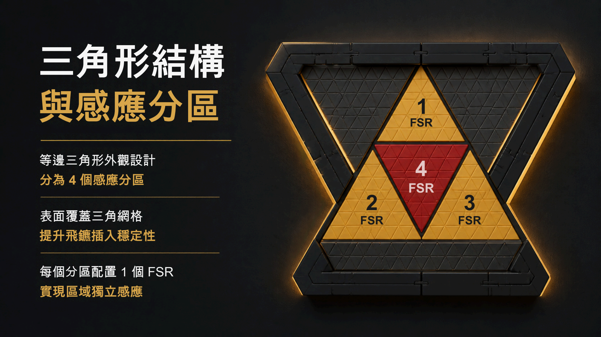
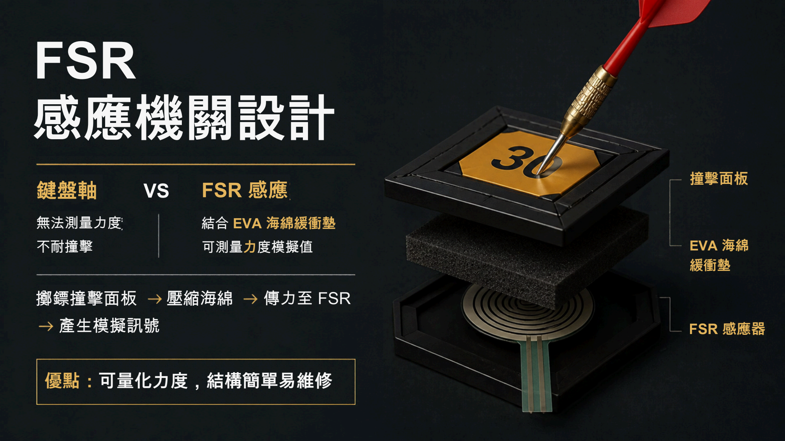
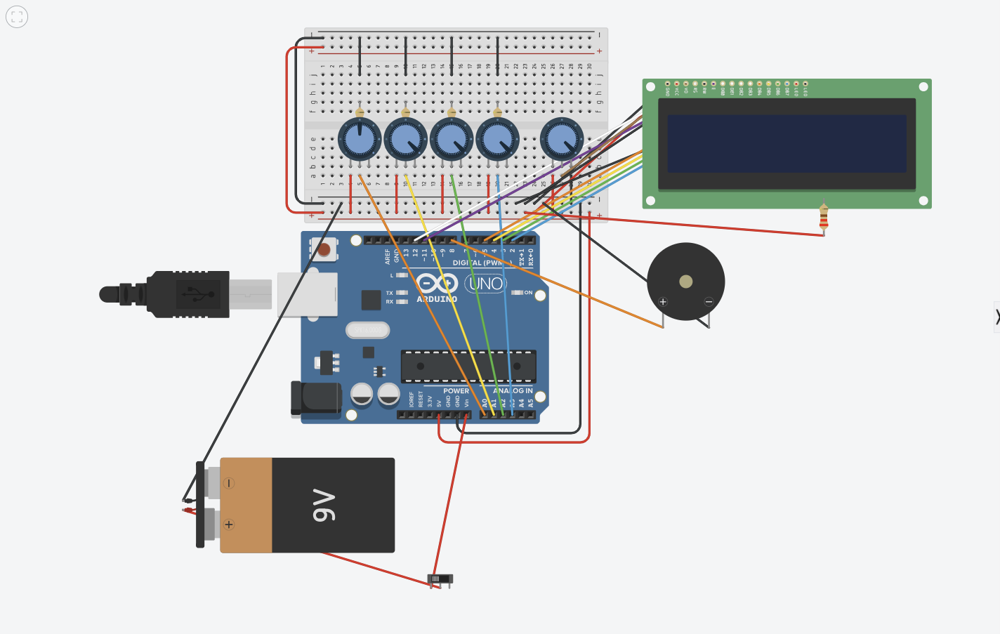
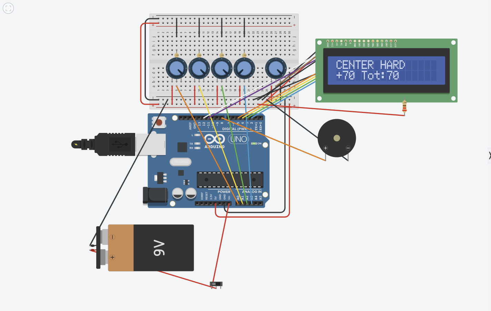

# GEST 3005 — Smart Triangular Dartboard circuit simulation

Design: [GEST3005 Prototype simulation 1](https://www.tinkercad.com/things/fSkU8ixGOXg/editel)

Each FSR is mounted under one of the four 3D-printed tiles from the project brief. A dart hits the printed face, the face compresses the EVA foam, and the foam presses that tile’s FSR. The two FSR leads then leave the tile and enter the breadboard divider. Tinkercad cannot place the printed tile, so each channel is a 10 kΩ variable resistor named for that tile.

The sensing page and the Fusion 360 page number the same four tiles differently. The sensor number follows the sensing page. The tile number follows the printed piece.

| Sensor under the tile | Tinkercad name | Printed piece | Face | Analog pin | Light (0.1–3 N) | Medium (3–7 N) | Hard (7–10 N) |
|---|---|---|---|---|---|---|---|
| FSR1 | 1 | Tile 1, top | gold outer | A0 | +10 | +20 | +30 |
| FSR2 | 2 | Tile 3, lower left | gold outer | A1 | +10 | +20 | +30 |
| FSR3 | 3 | Tile 4, lower right | gold outer | A2 | +10 | +20 | +30 |
| FSR4 | 4 | Tile 2, red center | center | A3 | +30 | +50 | +70 |





The product uses a real FSR under each tile. In Tinkercad the sensing element on each channel is a **variable resistor whose maximum is 10 kΩ**, wired as a rheostat in series with a fixed **10 kΩ** resistor to GND:

`5V — variable resistor (0–10 kΩ) — analog pin — 10 kΩ — GND`

That is not the LCD contrast pot. The contrast pot is a separate **250 kΩ** part on V0. Each sensing variable resistor has two leads on neighbouring breadboard columns. Turning the knob lowers its resistance and raises the analog reading. At the 10 kΩ stop there is no force. At 0 Ω the sketch treats the press as 10 N.

`dartboarddemo.ino` maps that resistance linearly to newtons, then picks the score from the table above:

| Sensor resistance | Approx. ADC | Force | Band |
|---|---|---|---|
| 10 kΩ | ~512 | 0 N | no hit |
| 7 kΩ | ~602 | 3 N | start of `MEDIUM` |
| 3 kΩ | ~787 | 7 N | start of `HARD` |
| 0 Ω | 1023 | 10 N | full `HARD` |

`LIGHT` is 0.1–3 N, `MEDIUM` is 3–7 N, and `HARD` is 7–10 N. A knob left at 10 kΩ does not score. An earlier build used Tinkercad’s Force Sensor part (`sensorForce`) with a non-linear 0–10 N slider; that curve is not what `dartboarddemo.ino` uses.



## What the sketch does

A hit is accepted only when one sensor is clearly above the others (crosstalk margin of 80 ADC counts) and the estimated force is at least 0.1 N. Pressing two sensors equally scores nothing. A dart that stays pressed scores once. The next dart is accepted only after every sensor falls back below 0.1 N.

The same two facts are written to the LCD and to the serial monitor on the laptop. `Serial` runs at 9600 baud over the USB cable, so a bench test with that cable plugged in shows the score and the force range on the computer. On the wall, with only the 9 V battery, the LCD is the display that remains. `lcd.clear()` is not used, because this simulator often drops the text that is printed immediately after a clear.

The force range is the full word `LIGHT` (0.1–3 N), `MEDIUM` (3–7 N), or `HARD` (7–10 N). The longest top line is `T2 CENTER MEDIUM`, which is exactly 16 characters, so the range is not cut off. With no force both displays show:

```
Dartboard ready
Score: 0
```

A center medium hit then shows the zone and the range on the first line and the running total on the second:

```
T2 CENTER MEDIUM
Score: 50
```

The serial monitor prints the same pair, plus the measured force and the points just added: `T2 CENTER MEDIUM Score: 50 4.2N +50`. The buzzer pitch follows that range: 880 Hz light, 1100 Hz medium, 1500 Hz hard.

That idle screen was checked in the running simulator after this sketch was loaded. The scored-hit rows in the next section are from the earlier 250 kΩ potentiometer stand-in, before the sensing pots were set to a 10 kΩ maximum and the linear 0–10 N map in `dartboarddemo.ino`.

## Earlier potentiometer runs

The first build had no Force Sensor part, so each FSR was a 250 kΩ potentiometer wired as a rheostat. Turning a knob fully clockwise drove the analog pin to 1023. Those runs proved the LCD, the buzzer, the one-score-per-press rule, and the crosstalk check. The zone names on those lines are the old labels. The pins are the same four inputs used now.

With no force, the LCD stayed on `Dartboard ready` / `Total: 0` and the buzzer was silent.

Holding the center knob fully clockwise produced one score and then stopped:

- LCD: `CENTER HARD` / `+70 Tot:70`
- Serial: `CENTER raw=1023 +70 total=70`
- The same display was still showing at simulator time 00:00:04, so the held press did not keep adding points.

After those pots were renamed to the printed tiles, the same center press scored once as `T2 CENTER raw=1023 +70 total=70` at simulator time 00:00:02. That is FSR4 under printed tile 2.



Separate runs, each starting from zero force:

| Test | Serial line | Result |
|---|---|---|
| FSR1 medium | `OUTER1 raw=292 +20 total=20` | pass |
| FSR2 medium | `OUTER2 raw=292 +20 total=20` | pass |
| FSR3 hard | `OUTER3 raw=1023 +30 total=30` | pass |
| FSR4 medium | `CENTER raw=292 +50 total=50` | pass |
| FSR1 and FSR2 both fully pressed | no new line | pass, rejected as crosstalk |
| FSR1 barely turned | no new line | pass, below the hit threshold |

## Wiring

Breadboard connectivity follows `BreadBoardschematic.jpg`: red and blue rails are horizontal buses, and each a–e or f–j column is its own vertical group of five holes. The top rail pair is jumpered to the bottom rail pair. The `w` rail is 5 V and the `x` rail is GND.

Each 10 kΩ sensing variable resistor bridges two neighbouring columns. One lead is tied to 5 V. The other lead is the analog node: it goes to an Uno analog pin, through a fixed 10 kΩ resistor, to GND.

| Sensor | 5 V side | Analog node | Uno pin | 10 kΩ to GND |
|---|---|---|---|---|
| 1 (FSR1, tile 1) | column 4, hole b | column 5 | A0 | e5 to g5, j5 to the GND rail |
| 2 (FSR2, tile 3) | column 9 | column 10 | A1 | e10 to g10, j10 to the GND rail |
| 3 (FSR3, tile 4) | column 14 | column 15 | A2 | e15 to g15, j15 to the GND rail |
| 4 (FSR4, tile 2) | column 19 | column 20 | A3 | e20 to g20, j20 to the GND rail |

| Function | Connection |
|---|---|
| LCD RS, E, D4–D7 | Uno D12, D11, D5, D4, D3, D2 |
| LCD R/W, VSS, backlight K | GND rail |
| LCD VDD | 5V rail |
| LCD backlight A | 5V through 220 Ω |
| LCD contrast (V0) | wiper of the 250 kΩ contrast potentiometer; the other two ends are 5 V and GND |
| Piezo | Uno D8 and GND |
| 9V battery | negative to GND; positive through the slide switch to Uno VIN only |

The contrast potentiometer is 250 kΩ. It is not one of the four sensing variable resistors, and it is not one of the four fixed 10 kΩ pull-downs. Its knob has to stay at that full 250 kΩ setting (Tinkercad Position 1), which parks the wiper at the GND end and holds V0 near 0 V. That is the only setting that keeps the score readable. Turning the knob so the wiper resistance falls below 250 kΩ raises V0, and the LCD then shows `error` instead of the zone and the score. Leave this knob alone during a scoring run. The sensing pots max out at 10 kΩ. The fixed divider resistors on A0–A3 stay at 10 kΩ.

The 9 V battery is the power source for the finished board, so the dartboard can hang on a wall and run with no laptop attached. The positive lead goes through the slide switch into Uno VIN, and the negative lead goes to GND. VIN is the unregulated input. The Uno’s onboard regulator turns that 9 V into the 5 V rail that actually feeds the microcontroller, the LCD, the piezo, and the four sensing dividers. A 9 V alkaline cell sits in the range VIN accepts (about 7–12 V). A direct 5 V pack would have nothing for that regulator to drop, and wiring 9 V straight onto the 5 V pin would over-voltage the chip and the LCD.

The battery is not tied to the 5 V rail. The switch is the on/off control for that standalone supply: open the switch and VIN is disconnected. In Tinkercad the Uno is still powered by the virtual USB port during simulation, so the slide switch does not actually turn the board off on screen. The wire is still the real circuit. USB is only how the simulator, and later a programming cable, powers the Uno on the bench.

## Sketch

`dartboarddemo.ino` is the demo sketch for the 10 kΩ variable-resistor build. It averages eight `analogRead` samples, converts the reading with `SENSOR_MAX_OHMS = 10000` and `DIVIDER_OHMS = 10000` (10 kΩ at rest → 0 N, 0 Ω → 10 N), then scores the winning tile. Each accepted hit writes the zone and the force range (`LIGHT`, `MEDIUM`, or `HARD`) plus the score to the 16×2 LCD and to the serial monitor. A held press scores once. The next dart is accepted only after every sensor is below 0.1 N.

`dartboard/dartboard.ino` still has the older Force Sensor curve for the `sensorForce` part. Use `dartboarddemo.ino` when the breadboard sensors are 10 kΩ variable resistors.

## What the earlier worker did not finish

[Read terminals, finish circuit](b5febc9c-dbee-4f25-bd01-700a278221cb) placed this circuit and proved the LCD could display a score, then died with `Connection failed repeatedly` before writing a report. Two problems showed up while checking its work:

1. Model edits made outside Tinkercad’s record/undo transaction do not persist. A reload had dropped the circuit back to the breadboard, the Uno, and two floating parts. Rebuilding inside `root.rec()` / `root.stopRec()` survived a reload: 16 parts and 63 wires came back.
2. Terminals 1 and 4 are R 4.6.1 sessions. The vscode-R session watcher cannot install `sess` because downloads of `processx`, `jsonlite`, and `rstudioapi` from cloud.r-project.org timed out at 60 seconds. Terminals 2 and 3 are idle shells. None of them is part of the circuit.

The Waveshare ESP32-C6 display from the power diagram is not in Tinkercad, so it is not in this simulation. The Uno scoring circuit is the part the project brief asked to simulate.
